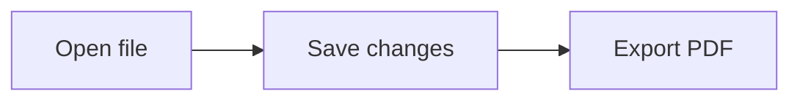

# What is it?

A local, modular file-rendering toolkit. Convert PDF to Markdown with MarkItDown, preview saved Markdown with live updates, export a formatted PDF, combine photos into one PDF, extract/delete/reorder PDF pages, or download audio from a URL and convert audio formats. Preview content stays in memory; no rendered document or work-in-progress cache is saved. See [description.md](description.md) for architecture, limitations, and development details.

# How to use

Requires Node.js 22 or newer and npm. Chrome or Chromium is needed for Markdown PDF export and Mermaid diagrams; ordinary Markdown preview works without it.

```bash
cd /home/a/Documents/products/toolkit
npm install
npm start
```

Open **http://127.0.0.1:4177** (or the local address printed in the terminal if you chose another port). No token or URL fragment is needed; allow cookies for this local address. Enter an absolute Markdown path, a `~/` path, or a path relative to the directory where you started the app. Click **Open file**, or **Open example**. Edit the original file in your usual editor and **save** it: the preview updates automatically. Use **Source** to inspect the saved Markdown, or the outline to jump to a heading. The interface and preview use a dark black-and-white theme. Use **Hide sidebar** or **Show sidebar** to completely hide or reopen the outline.

Use **Customize tools** to hide tools you are not using (for example OMR scan),
move tools earlier/later, or **Restore defaults**. These choices are remembered
in this browser; only toolbar preferences are saved. Hidden tools keep their
current content and can be shown again at any time.

For **JS / MJS → SVG**, choose a `.js`/`.mjs` file or paste code, click
**Generate SVG**, enter a filename and click **Download SVG**. Chrome/Chromium
is required.

For **Scribd PDF**, keep the downloader checkout in `src/scribd-downloader`,
install matching Chromium and ChromeDriver, then run `npm run scribd:setup`.
Paste a document URL, optionally set the filename and click **Generate PDF**.
When ready, use the preview, **Open PDF**, or **Download PDF**. **Cancel** stops
an export. Links stay local to this toolkit session and expire after 15 minutes.

For **PDF to Markdown**, install the optional local converter once:

```bash
npm run pdfmd:setup
```

Choose a PDF, click **Convert to Markdown**, review the result, then **Download
Markdown**. MarkItDown extracts existing text; it does not OCR image-only scans
or guarantee the original visual layout. PDFs are processed on the local toolkit
server without cloud services. The original PDF is unchanged.

Open the same local address in additional tabs or windows to work on different Markdown files. Each page keeps its own path, outline, preview, file watching, and export settings. Changing a path in one page does not affect another. Refreshing or duplicating an active page starts an independent view of its selected file.

Click **Zen mode** to fill the window with only the rendered document. Press **Esc** to return to the controls, including when the document has keyboard focus. Saved-file changes continue to update while reading. Your previous Preview/Source view and sidebar state return when you exit.

For an existing PDF, click **PDF pages** and **Open PDF** to choose a local file.
Enter original page numbers such as `1-3, 7, 5`, choose **Keep / reorder these
pages** or **Delete these pages**, then click **Apply**. Press **Enter** in the
page-number field to apply the selection and preview the result immediately. The page list also has
earlier/later and delete buttons; **Restore all pages** resets it. Use **Preview
result**, choose a new filename and click **Save as new PDF**. The browser downloads
a separate PDF; the original stays unchanged. Editing runs in the current browser
page without uploading the PDF. Each tab has its own PDF selection. The preview
uses your browser's PDF viewer; **Open preview in new tab** is available if it
cannot display embedded PDFs. Page editing also works without Chromium installed
on the server. Password-protected PDFs and interactive forms are not supported.

To combine photos, click **Photos to PDF**, then **Add photos** and select several
JPEG, PNG, WebP or AVIF files. You can add more batches, move photos earlier/later,
remove individual photos, or clear the list. Choose **A4**, **Letter** or **Fit
photo**, enter a filename, then click **Save photos as PDF**. Each photo becomes
one page in list order. A4/Letter pages automatically use portrait or landscape
orientation and fit the whole image without cropping; Fit photo has no margins.
Photo processing stays in the current browser tab and leaves the originals
unchanged. No uploads or server-side Chromium are needed for this tool.

For scanned scores, Python 3, Poppler (`pdfinfo`, `pdfimages`, `pdftoppm`),
Pillow and NumPy are also needed. Click **OMR scan**, choose a PDF page, and compare the
source-resolution render with **Preserve pixels**, **Contrast normalization**,
or a small **Manual deskew** rotation. Save the selected page as a separate
candidate PDF to try in an OMR engine; save the JSON report to keep its source
hash and processing details. The original stays unchanged. This tool does not
recognize notes or establish that a candidate is more accurate. See
[description.md](description.md) for the local processing and limitations.

For local file format conversion, open **Photo formats**, **Audio formats**, or
**Video formats**. Select a file, choose the output format and filename, then click
**Convert … and download**. Each result is saved separately; originals are not
changed. The three tools can be hidden/reordered with **Customize tools**.

- Photos: JPG, PNG, WebP, AVIF, TIFF, linear DNG. EXIF direction is applied; JPG uses white behind
  transparency. Animated image inputs use only their first frame.
- Audio: MP3, FLAC, WAV, ALAC (`.m4a`), M4A/AAC, AAC, Opus, OGG.
- Video: MP4, WebM, MKV, MOV/H.264, ProRes 422 HQ (`.mov`), AVI; includes the first audio track when present.

Install or update photo support with `npm run formats:setup` (Python 3/venv required).
DNG inputs are developed locally; TIFF output retains their 16-bit RGB data.
DNG export produces linear RGB, not recovered camera sensor RAW; transparency
is flattened onto white.
Install project-local FFmpeg and ffprobe with `npm run ffmpeg:setup`.
Audio/video conversion uses only `tools/ffmpeg/<platform>-<arch>/bin`, with no
system PATH fallback. Files are processed
on this computer by the local toolkit server. Input limits: photos 25 MB and
32 megapixels, audio 100 MB, video 250 MB. **Cancel current conversion** works
even after switching between these three tools. Lossy formats re-encode the
source; converting to a lossless format cannot recover discarded information.

For URL audio downloads and local audio conversion, install the optional media
support once (Python 3 with venv support, plus project-local FFmpeg installed using `npm run ffmpeg:setup`):

```bash
npm run media:setup
```

Open **URL audio**, paste a public video/audio/page/playlist URL, then click **Find
media**. Select one or more listed items, choose **MP3**, **FLAC** or **Original
audio**, and click **Download selected audio**. One item downloads as an audio
file; multiple items download together as a ZIP. Videos are reduced to their
soundtrack. The scanner lists at most 100 items; download up to 20 at a time.
Supported websites depend on yt-dlp; login-only or protected media may fail.

Use **Convert local audio** to convert an existing file to MP3 or FLAC. FLAC keeps
lossless encoding of the decoded source; it cannot restore details missing from
a compressed original. Conversion uses the local toolkit server and preserves
the input file. **Cancel** stops processing. URL requests happen only after an
explicit scan/download; audio work uses temporary files which are removed after
cancellation or errors. Ready URL audio stays available for 15 minutes and is
then removed; the download link can be reused during that time. Re-run
`npm run media:setup` to update yt-dlp.

Select **A4** or **Letter** and **White paper**, **Yellow paper**, or **Black paper**, then click **Export PDF** to download the current saved version. PDF background defaults to white and is independent of the dark preview. A heading and its content up to the next heading move together to the next page when they do not fit; sections longer than a full page can span pages. No PDF is generated automatically. Your browser controls the download location.

Use a fenced `mermaid` block for diagrams in both preview and PDF:

````markdown

````

Save the file to update the diagram. Invalid diagrams show their source and an error message; other content remains readable. **Open example** includes a working diagram.

You can also start with a target file:

```bash
npm start -- /path/to/notes.md
npm start -- /path/to/notes.md --port 4180 --interval 500
```

The default address is `127.0.0.1:4177`, with a 300 ms file check interval. `--port 0` selects an available port. Set `TOOLKIT_CHROMIUM` to your Chrome/Chromium executable if it is not detected:

```bash
TOOLKIT_CHROMIUM=/path/to/chromium npm start
```

For login startup on Linux with systemd, run:

```bash
npm run autostart:install
systemctl --user start toolkit.service
```

The user service starts toolkit at **http://127.0.0.1:4177** when you log in. Stop
an existing manually launched toolkit before starting the service on the same
port. Use `systemctl --user stop toolkit.service` to stop it, or
`npm run autostart:remove` to remove login startup. Re-run the installer after
moving the product or changing the Node.js installation path.

A manually launched `npm start` stops with **Ctrl+C**. To remove the toolkit,
remove its login service if installed, stop it and delete this folder; original
Markdown/PDF files and downloads elsewhere remain yours.

For **live TeX → PDF**, use **Markdown / TeX to PDF** and open a saved `.tex`
path. Install XeLaTeX (`texlive-xetex` on Arch); set `TOOLKIT_TEX_ENGINE` to another
installed TeX engine if needed. Save edits in your editor to update the preview,
including local files referenced by `\input` and local graphics. **Source** shows
the saved source; **Open PDF preview in new tab** is available if the embedded
viewer does not display it. **Save PDF** is the explicit download step. Paper
size and colors come from the TeX document. Compiler logs, auxiliary files and
intermediate PDFs use a temporary directory that is removed after success,
errors or cancellation; no compiler files are placed beside your source. A
failed compile keeps the last successful preview and disables saving until fixed.
Bibliography/index processors and automatic missing-package installation are not
run. See [description.md](description.md) for limits.

For native circular desktop tools, the held Super+Alt+click integration and
FileX's **T** vertical tool menu, install the adjacent
[Arch/KDE integration](https://github.com/Azusalina/integrate-toolkit-arch/blob/master/README.md). Its native save dialog
lets you choose the result directory and filename. This integration is separate
from the existing local web login service.

This is an independent repository at `/home/a/Documents/products/toolkit`, published as [Azusalina/toolkit](https://github.com/Azusalina/toolkit). Run `git add`, `git commit`, and `git push` here. Its source has moved out of `someProducts`; hub pushes no longer publish this project.


**URL audio:** choose the listed items and MP3/FLAC/original, then download.
Progress shows the background download and conversion stages; **Cancel** stops
the task. The ready link downloads directly through your browser and stays
available for 15 minutes, including retries. **Check progress** reconnects after
a temporary status connection failure in the same page. Source limit: 1 GiB per
item; result: 2 GiB; processing: 60 minutes; temporary working space: up to 4 GiB
per active task. FLAC can be much larger than the source; choose original audio
to avoid re-encoding or MP3 for a smaller file.
